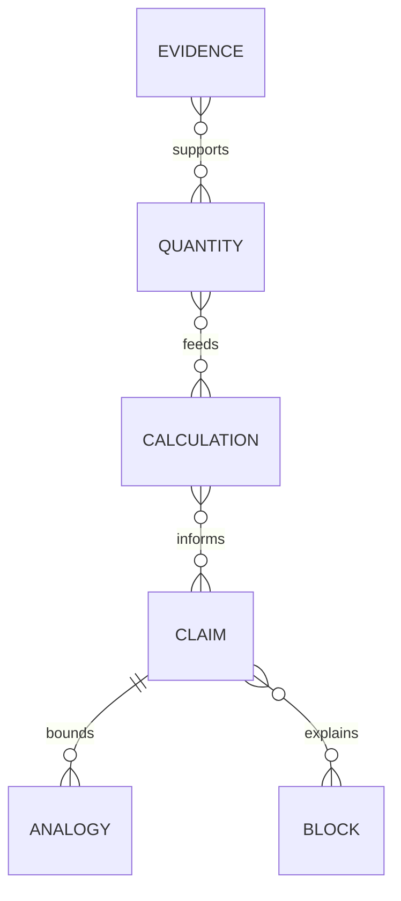

# 领域与本体设计

## 专业聚合

Evidence固定资料、Quantity带单位数值、Calculation依赖计算、Claim解释主张、Analogy类比边界、Block文章段落、Note意见。根字段：evidence、quantities、calculations、claims、analogies、blocks、notes、basis_refs。专业对象以WorkRef＋owner_plugin_id＋object_id确定身份，revision＋sha256固定内容。相同标题不代表同一对象。

引文只追加并核验UTF-8字节。有限单位表按SI量纲和精确有理数运算，不使用浮点近似冒充精确结果；加减要求同量纲，除零、未知单位及计算依赖循环拒绝。主张固定证据、所用数量及计算组合摘要，类比说明对应关系与失效边界。文章段落固定主张及内容，依据变化后旧主张、段落与意见待复核。计算正确不认证科学结论、教学效果或现实安全。

所有集合ID唯一、所有引用存在、集合有界、顺序在对应父级唯一。撤销先处理依赖，不能制造悬空引用；来源索引只追加，整本保存不能改变原索引意义。跨包引用只携带固定Owner、对象、修订与摘要，通过公开SDK回读，不导入对方私有结构。

## 权属

原始资料、作品身份与受管事务归Core；专业记录归本包；理解、创作与解释归作者选择的外部Agent；表达取舍与定稿归作者。借助欧卡姆原理复用通用事实，只增加本旅程需要的专业状态。
